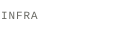

<a href="https://mooner.dev">
  <picture>
    <source media="(prefers-color-scheme: dark)" srcset="assets/hero-dark.svg">
    
  </picture>
</a>

  <a href="https://mooner.dev">mooner.dev</a>
  &nbsp;·&nbsp;
  <a href="mailto:siwol@mooner.dev">siwol@mooner.dev</a>
  &nbsp;·&nbsp;
  Discord <code>mooner.dev</code>

Computer Engineering student at Hanyang University (ERICA), self-taught since 2016. Away from the screen, I do 3D printing and CAD.

### Projects

- **[NeonJS](https://github.com/mooner1022/neon-js)** · A JavaScript engine for the JVM, written in Kotlin. Bytecode interpreter, JIT to JVM bytecode, runs on Android. Test262 48,747 / 48,747.
- **[AMOA](https://mooner.dev/en/projects/amoa/)** · Hybrid-search backend on Ktor and PostgreSQL. pgvector ANN and pg_trgm merged with RRF, fed by an outbox-driven embedding pipeline.
- **[지금 한강은｡](https://mooner.dev/en/projects/hanriv/)** · Real-time Han River water temperature for Android. Live since 2018, with 51K+ installs on Google Play.
- **[Project StarLight](https://github.com/mooner1022/StarLight)** · Scriptable messenger auto-reply framework for Android, built around a plugin API.

### Award

- **2nd place (최우수상), [SaveTax Hackathon](https://web.archive.org/web/20261109103437/https://hackathon.savetax.now/close-notice/results.html)** · 2026.10, solo entry among 1,169 entrants. Proved ₩9.49B in price gaps across Korea's public procurement store. [Yonhap News](https://www.yna.co.kr/view/AKR20261109113200001)

### Stack

  <picture><source media="(prefers-color-scheme: dark)" srcset="assets/stack/label-languages-dark.svg"></picture>
  <picture><source media="(prefers-color-scheme: dark)" srcset="assets/stack/kotlin-dark.svg"></picture>
  <picture><source media="(prefers-color-scheme: dark)" srcset="assets/stack/java-dark.svg"></picture>

  <picture><source media="(prefers-color-scheme: dark)" srcset="assets/stack/label-backend-dark.svg"></picture>
  <picture><source media="(prefers-color-scheme: dark)" srcset="assets/stack/ktor-dark.svg"></picture>
  <picture><source media="(prefers-color-scheme: dark)" srcset="assets/stack/exposed-dark.svg"></picture>
  <picture><source media="(prefers-color-scheme: dark)" srcset="assets/stack/spring-boot-dark.svg"></picture>

  <picture><source media="(prefers-color-scheme: dark)" srcset="assets/stack/label-android-dark.svg"></picture>
  <picture><source media="(prefers-color-scheme: dark)" srcset="assets/stack/compose-dark.svg"></picture>

  <picture><source media="(prefers-color-scheme: dark)" srcset="assets/stack/label-data-dark.svg"></picture>
  <picture><source media="(prefers-color-scheme: dark)" srcset="assets/stack/postgresql-dark.svg"></picture>
  <picture><source media="(prefers-color-scheme: dark)" srcset="assets/stack/redis-dark.svg"></picture>

  <picture><source media="(prefers-color-scheme: dark)" srcset="assets/stack/label-infra-dark.svg"></picture>
  <picture><source media="(prefers-color-scheme: dark)" srcset="assets/stack/docker-dark.svg"></picture>
  <picture><source media="(prefers-color-scheme: dark)" srcset="assets/stack/github-actions-dark.svg"></picture>
  <picture><source media="(prefers-color-scheme: dark)" srcset="assets/stack/aws-dark.svg"></picture>
  <picture><source media="(prefers-color-scheme: dark)" srcset="assets/stack/terraform-dark.svg"></picture>

